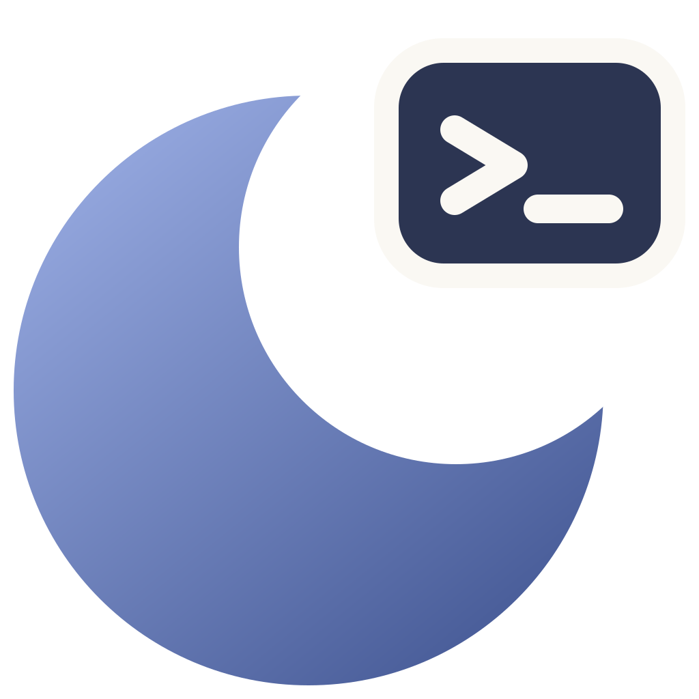
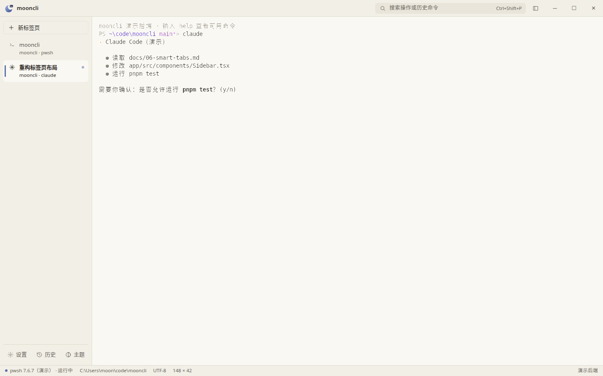
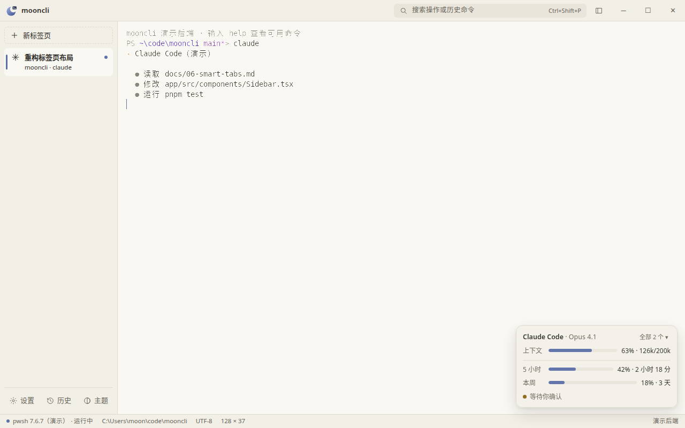
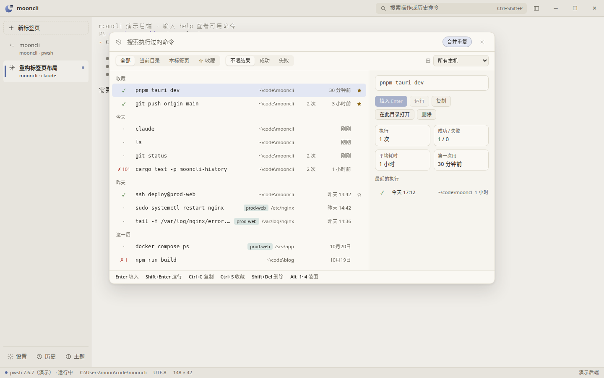
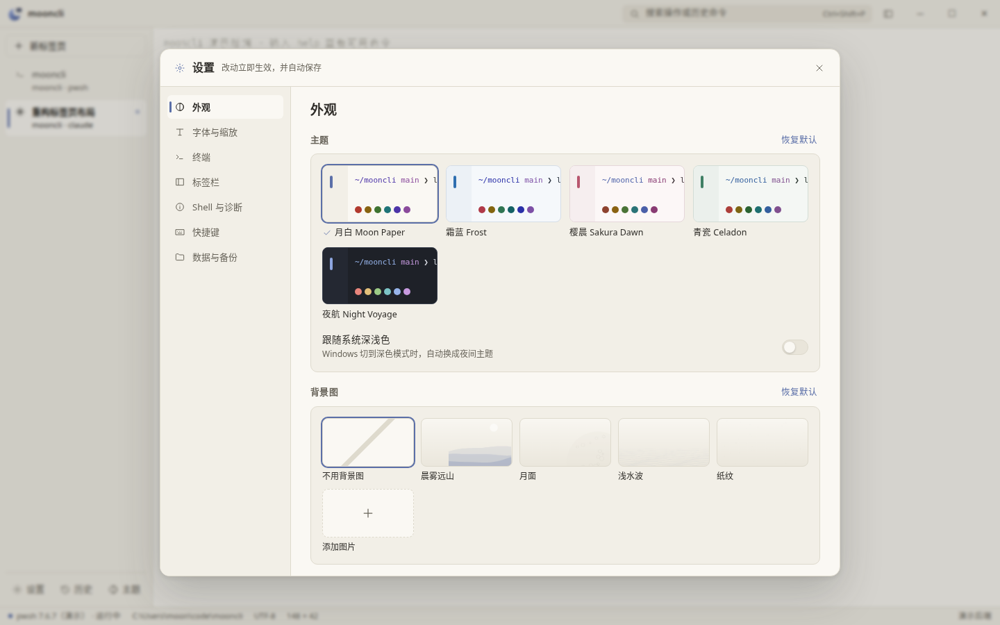

<p align="center"></p>

<h1 align="center">mooncli</h1>

<p align="center"><b>A Windows terminal for the AI-agent era: PowerShell 7 at the core, light-first themes, a memory for your commands, and a clear view of what Claude Code and Codex are doing.</b></p>

<p align="center">
<a href="https://github.com/moonmxi/mooncli/releases/latest"></a>
<a href="https://github.com/moonmxi/mooncli/actions/workflows/ci.yml"></a>
<a href="LICENSE"></a>

</p>

<p align="center">
<a href="https://github.com/moonmxi/mooncli/releases/latest">Download</a> ·
<a href="https://github.com/moonmxi/mooncli/releases/tag/nightly">Nightly builds</a> ·
<a href="docs/README.md">Docs (Chinese)</a> ·
<a href="README.md">中文</a>
</p>



_The UI is in Chinese for now; English localization is on the roadmap._

## Why mooncli

**See your agents' quotas and progress at a glance.** A small card always lists the 5-hour and 7-day quotas of both Claude Code and Codex, with reset countdowns. When the current tab is running an agent, it also shows that session's context usage. When a turn finishes or the agent needs your approval, you get a Windows notification; click it to jump back to that tab. Data comes only from official channels, never from your login credentials.



**Remembers every command you type.** The history database records where each command ran, on which host, whether it succeeded, and how long it took. `Ctrl+Shift+R` opens the history panel (filter by directory, host, result, favorites); `Alt+/` opens the completion panel at the prompt, merging history, command docs, and pwsh's own completions.



**Tabs that understand what's running.** Each tab shows its directory, git branch, and the running program (detected from the process tree, so `npm run dev` shows up as node). Tabs adopt the titles and icons Claude Code and Codex set. Background tabs light up when a long command finishes, the bell rings, or an agent is waiting, and the taskbar flashes if the window is in the background.

**Light themes done right.** Five built-in themes (Moon Paper, Frost, Sakura Dawn, Celadon, and the dark Night Voyage), all contrast-checked. Wallpapers, fonts, and three kinds of scaling; import Windows Terminal color schemes. oh-my-posh and starship prompts render unchanged.



## Features

| | |
| --- | --- |
| Agents | 5-hour and 7-day quotas for Claude Code / Codex, current-session context, notifications when a turn ends or approval is needed; one-click setup (preview first, automatic backup, exact undo) or manual config |
| Commands | Command blocks (success/failure dots, scrollbar marks, `Ctrl+↑↓` to jump, select a command's output), find in output `Ctrl+Shift+F`, history panel, completion panel |
| Tabs & panes | Side or top tab bar, drag to reorder, pin, rename, color; split panes `Ctrl+Shift+E` / `Ctrl+Shift+O`; restores your tabs and directories |
| Remote | Recognizes ssh, mosh, wsl, docker exec and more: the connect command finishes once connected, then each remote command is timed and recorded separately; keys pass through untouched, so remote TAB completion works |
| Feel | GPU rendering, smooth scrolling, smart copy/paste, multi-line paste confirmation, `Ctrl+Shift+P` command palette, every shortcut remappable |
| Your data | Daily settings backups with restore, full export/import; settings reload live on save, with a JSON Schema; logs stay local and can be bundled in one click |
| Setup | A guided install if PowerShell 7 is missing; ships a newer ConPTY so shell integration is reliable on older Windows builds |

## Install

Download `mooncli-setup-x64.exe` from [Releases](https://github.com/moonmxi/mooncli/releases/latest) and run it. For the latest changes, use [nightly](https://github.com/moonmxi/mooncli/releases/tag/nightly), rebuilt on every push to main.

Requires Windows 10 / 11 and [PowerShell 7](https://aka.ms/PSWindows) (mooncli offers a one-click winget install if it's missing).

The installer is **not code-signed** yet, so Windows may warn about an unknown publisher: click **More info → Run anyway**. See [docs/10](docs/10-release.md) for details.

### Turning on agent quotas and notifications

1. Settings (`Ctrl+,`) → Agent → connect Claude Code and Codex. You see the exact changes before anything is written, and the original files are backed up.
2. Turn on the quota card. Quotas work without connecting: mooncli asks your local Claude Code (`claude /usage`, Pro / Max plans) and Codex (app-server) directly. Connecting adds turn-complete notifications and refreshes quotas right after each turn.
3. Click "Send test notification" to make sure notifications show up.

## Development

Requires Rust (stable), Node.js 22 + pnpm 10, and PowerShell 7.

```powershell
cd app
pnpm install
pnpm tauri dev      # run the desktop app
pnpm dev            # UI only, in a browser with a mock shell: http://localhost:1420
pnpm test           # UI logic tests
cd ..
cargo test          # core library tests; runs end-to-end tests in a real pwsh when one is installed
```

GitHub Actions builds, tests, and packages on Windows for every push, publishing to the `nightly` pre-release; `v*` tags publish stable releases. See [CONTRIBUTING.md](CONTRIBUTING.md).

## Privacy

This program will not transfer any information to other networked systems unless specifically requested by the user or the person installing or operating it. Command history, settings, wallpapers, and agent data stay on your machine; "Check for updates" contacts GitHub only when you click it.

If the WebView2 runtime is missing, the installer downloads it from Microsoft (subject to the [Microsoft Privacy Statement](https://privacy.microsoft.com/privacystatement)).

## License

[MIT](LICENSE). Bundled third-party components: Symbols Nerd Font (MIT, `app/public/fonts/`) and Microsoft ConPTY (MIT, downloaded at build time).
