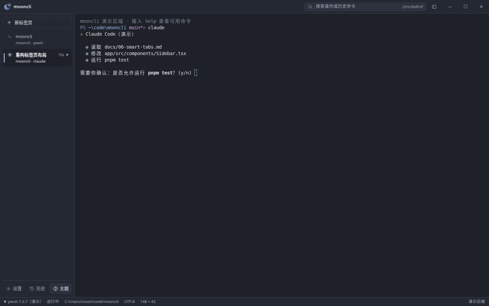

<p align="center"></p>

# mooncli

**A third-party terminal for Windows, built on PowerShell 7 (pwsh).**

[中文 README](README.md)

Good-looking (especially in light themes), able to remember your commands, pleasant to use, and aware of what every tab is doing — especially when a tab is running an AI coding agent like Claude Code or Codex.

[](https://github.com/moonmxi/mooncli/releases)
[](https://github.com/moonmxi/mooncli/actions/workflows/ci.yml)
[](LICENSE)


[Download v0.1.1](https://github.com/moonmxi/mooncli/releases/tag/v0.1.1) · [Nightly builds](https://github.com/moonmxi/mooncli/releases/tag/nightly) · [Docs](docs/README.md) (Chinese)

## Screenshots


_Tabs adopt the titles and icons of agent sessions, and flag you when an agent is waiting for confirmation._





_The agent usage widget is opt-in (off by default). It only reads the session files Codex writes locally plus its official notify extension point — never any credentials._

_Screenshots were captured in the browser demo mode (mock shell). The desktop app has the same UI with a real pwsh._

## Features

### Available now (v0.1.1)

- **Light-first appearance system**: five built-in themes — Moon Paper, Frost, Sakura Dawn, Celadon (light) and Night Voyage (dark) — all contrast-checked. Wallpapers (four built in, or import your own), fonts, UI scaling, and follow-system light/dark mode.
- **Command memory**: a history library that records where and on which host each command ran, whether it succeeded, and how long it took. `Ctrl+Shift+R` opens the history panel with filters (directory, tab, favorites, success/failure, host), details, and statistics. Commands run over ssh are recorded and timed individually too.
- **Fluid feel**: GPU rendering, smooth scrolling, smart copy/paste, a copy toast, and multi-line paste confirmation. Over ssh, keystrokes pass through untouched so TAB completion keeps working; connecting counts as the command finishing.
- **Content-aware tabs**: the tab bar sits on the left or the top; tabs show the directory and the running program, adopt the titles and icons set by Claude Code / Codex sessions, and flag you when an agent is waiting for confirmation.
- **Fully customizable shortcuts**: record your own bindings, with conflict detection and two presets. `Ctrl+Shift+P` opens the command palette.
- **Your data stays yours**: daily automatic backups with restore, plus full export/import. If PowerShell 7 is missing, you get install guidance instead of a silent fallback to 5.1.
- **Agent usage widget** (opt-in, off by default): a floating card that follows the active tab and shows Codex context usage, 5-hour and weekly quotas, and session state. Data comes only from the rollout session files Codex writes locally (the quota snapshots are the same data as the official /status) and the official notify extension point — no credentials are read and no network requests are made. One-click connect/disconnect in Settings, with automatic backups before any config change.

### In progress

- Window materials (Mica / acrylic), a theme editor, palette import
- A completion panel and a persistent candidate panel
- Process-tree recognition

Progress is tracked in [docs/09](docs/09-roadmap.md) (Chinese).

## Download

- **Stable**: v0.1.1 on the [Releases page](https://github.com/moonmxi/mooncli/releases) — download `mooncli-setup-x64.exe` and run it.
- **Nightly**: on the [same page](https://github.com/moonmxi/mooncli/releases/tag/nightly), rebuilt on every push to `main`.

The installer is **not code-signed yet**, so Windows may warn about an "unknown publisher": click **More info → Run anyway**.

## Development

Requires Rust (stable), Node.js 22 + pnpm 10, PowerShell 7.

```powershell
cd app
pnpm install
pnpm tauri dev      # the real app
pnpm dev            # UI only, in a browser (mock shell), http://localhost:1420
pnpm test           # UI logic tests
cd ..\ncargo test          # core library tests
```

See [CONTRIBUTING.md](CONTRIBUTING.md) if you'd like to hack on it.

## Privacy

This program will not transfer any information to other networked systems unless specifically requested by the user or the person installing or operating it. Command history, settings, and wallpapers stay on your own computer.

If the WebView2 runtime is missing, the installer downloads it from Microsoft (subject to the [Microsoft Privacy Statement](https://privacy.microsoft.com/privacystatement)).

## License

[MIT](LICENSE). Bundled third-party components: Symbols Nerd Font (MIT, `app/public/fonts/`) and Microsoft ConPTY (MIT, downloaded at packaging time).
